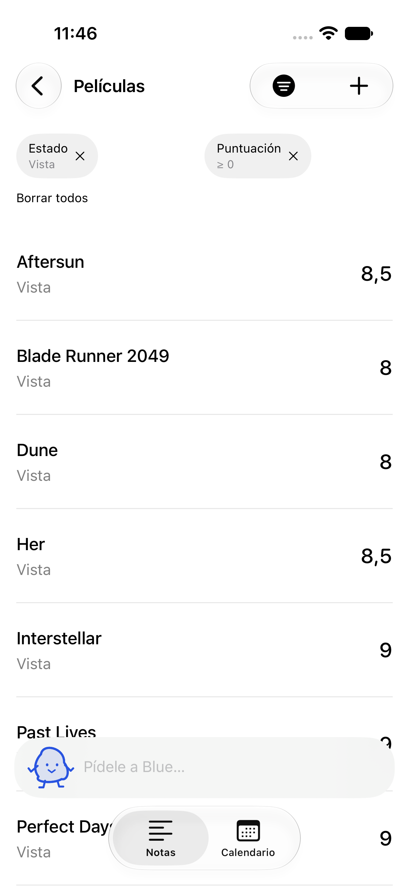
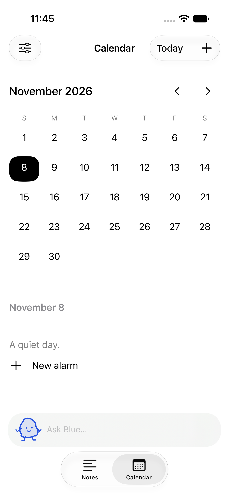

# Blue

A quiet home for Markdown notes, adaptable collections, and system alarms. This repository starts with the native iPhone app, built with SwiftUI, SwiftData, Foundation Models and AlarmKit, and leaves room for future platforms. English and Spanish (Spain). Everything stays on your device.

<p>
  
  
  
</p>

## Run locally

Requires Xcode 27.1 or later with an iOS simulator runtime; verified toolchain details are in [verification](docs/verification.md). The checked-in Xcode project opens directly:

```sh
open Blue.xcodeproj
scripts/build.sh Debug
scripts/run.sh
```

On Xcode 27, the simulator opens in Device Hub. Scripts select the Xcode developer directory per process. They do not modify your global `xcode-select` setting. Regenerate the project with XcodeGen 2.46.0 after changing `project.yml`.

```sh
scripts/check.sh
scripts/test.sh
scripts/build.sh Release
scripts/build-device.sh
scripts/test-model-mac.sh
BLUE_REAL_MODEL_TESTS=1 scripts/test.sh -only-testing:BlueTests/RealModelTests
scripts/profile.sh
```

The normal test suite uses isolated demo data, Swift Testing business/persistence tests, and XCTest UI flows. Real-model checks are opt-in and require Apple Intelligence availability. See the verification report for actual results and limits.

## Try it

Open Movies, edit a rating, sort/filter the list, and remove active filters directly. Use the plus button for a note, folder, collection, item or alarm. Collections can start as simple title-and-note lists and gain typed properties later. Change language in Settings without losing an open draft. Export your library as versioned JSON from Settings.

With Apple Intelligence ready, ask “What rating did I give Interstellar?”, jump to the exact row, then ask “Change Interstellar's rating to 10.” Blue validates and saves through the same store used by the editors. Without a local model, manual controls remain available and the assistant explains its availability.

## Install on your iPhone

Open the project in Xcode, choose your free **Personal Team**, connect the iPhone, and press **⌘R**. No paid Developer Program, App Store Connect, TestFlight, or distribution credentials are needed. [Personal Team setup and device checks](docs/release.md) explains signing, Developer Mode and the seven-day provisioning limit.

The repository is public. GitHub Actions runs formatting, localization, simulator tests and a Release compile; it does not publish or distribute builds.

- [Engineering rules](AGENTS.md)
- [Architecture and privacy](docs/architecture.md)
- [Design rationale](docs/design.md)
- [Verification and known limitations](docs/verification.md)
