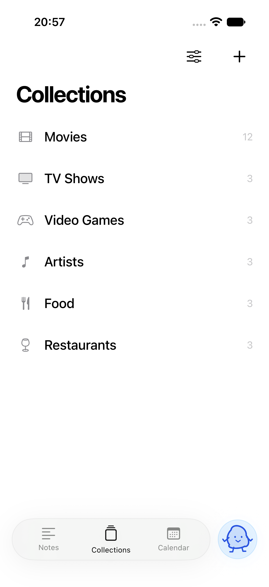
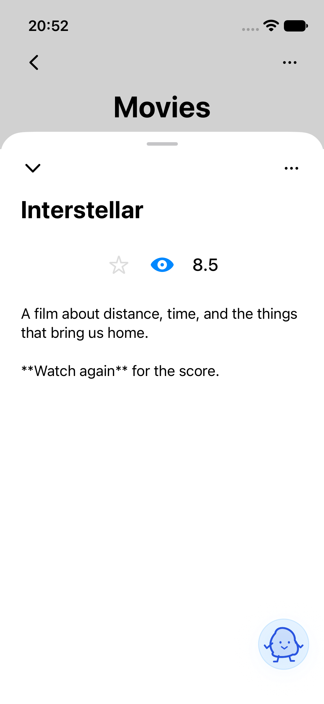
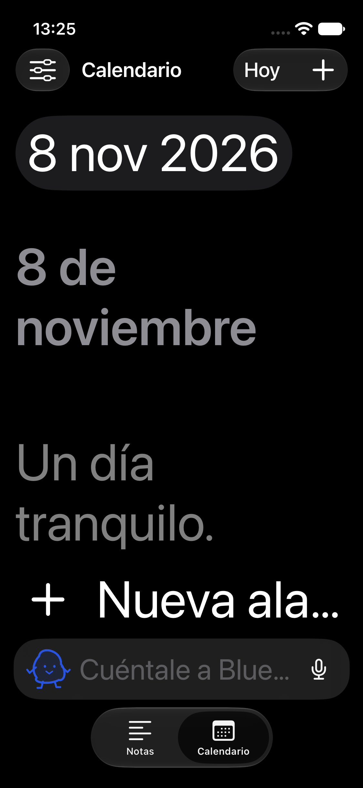

# Blue

A quiet home for Markdown notes, adaptable collections, and a calendar. This repository starts with the native iPhone app, built with SwiftUI, SwiftData, Foundation Models and AlarmKit, and leaves room for future platforms. English and Spanish (Spain). Your library and inference stay local; optional public facts come from Wikipedia with source links.

<p>
  
  
  
</p>

## Run locally

Requires Xcode 27.1 or later with an iOS simulator runtime; verified toolchain details are in [verification](docs/verification.md). The checked-in Xcode project opens directly:

```sh
open Blue.xcodeproj
scripts/build.sh Debug
scripts/run.sh
```

On Xcode 27, the simulator opens in Device Hub. Scripts select the Xcode developer directory per process. They do not modify your global `xcode-select` setting. Regenerate the project with XcodeGen 2.46.0 after changing `project.yml`.

```sh
scripts/check.sh
scripts/test.sh
scripts/build.sh Release
scripts/build-device.sh
scripts/test-model-mac.sh
BLUE_REAL_MODEL_TESTS=1 scripts/test.sh -only-testing:BlueTests/RealModelTests
scripts/profile.sh
```

The normal test suite uses isolated demo data, Swift Testing business/persistence tests, and XCTest UI flows. Real-model checks are opt-in and require Apple Intelligence availability. See the verification report for actual results and limits.

## Try it

Start with a plain-text note or an empty collection, or tell Blue what to save. The root has Collections, Notes and Calendar; Blue floats separately at the bottom right. Within a collection, fixed back/options controls sit above a scrolling title, count and sort row. Tap the current sort criterion to reverse it. Items open in large detail sheets with centered visual properties. Titles and text autosave as you type. Delete is a red minus in the options menu and opens a centered confirmation modal. Ask Blue to adapt fields/icons or apply and clear filters; no manual icon-filter bar is shown. Change language in Settings without losing drafts, and export a versioned JSON backup there.

With Apple Intelligence ready, ask “What rating did I give Interstellar?”, see the exact saved values in the assistant sheet, then ask “Change Interstellar's rating to 10.” Blue validates and saves through the same store used by the editors. Without a local model, manual controls remain available and the assistant explains its availability. The iPhone 13 mini does not support Apple Intelligence; the private web preview can use the Mac model. All deletions require confirmation. There is no Undo control.

## Install on your iPhone

Open the project in Xcode, choose your free **Personal Team**, connect the iPhone, and press **⌘R**. No paid Developer Program, App Store Connect, TestFlight, or distribution credentials are needed. [Personal Team setup and device checks](docs/release.md) explains signing, Developer Mode and the seven-day provisioning limit.

If the simulator cannot load Apple's model assets but the Mac model is available, use the explicit local development bridge:

```sh
scripts/start-model-bridge.sh
scripts/run.sh
# Opt-in simulator UI check with the real Mac model:
scripts/test-bridge.sh
# Stop the helper when finished:
launchctl remove app.iorb.blue.model-bridge
```

Settings identifies the Mac bridge. It uses real Apple Intelligence, runs only on loopback, and is absent from iPhone/Release builds. Simulator alarms still need hardware verification. Tap the microphone for on-device dictation when available; Enter sends and tapping outside dismisses chat.

The repository is public. GitHub Actions runs formatting, localization, simulator tests and a Release compile; it does not publish or distribute builds.

- [Engineering rules](AGENTS.md)
- [Architecture and privacy](docs/architecture.md)
- [Design rationale](docs/design.md)
- [Verification and known limitations](docs/verification.md)
